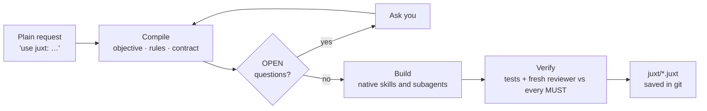

<p align="center">
  <a href="https://juxt-lang.github.io/juxt/"></a>
</p>

<p align="center">
  <a href="https://github.com/juxt-lang/juxt/actions/workflows/validate.yml"></a>
  <a href="LICENSE"></a>
  
  
  
</p>

<p align="center">
  <a href="https://juxt-lang.github.io/juxt/"><b>Website</b></a> ·
  <a href="#quick-start"><b>Quick start</b></a> ·
  <a href="spec/LANGUAGE.md"><b>Language</b></a> ·
  <a href="examples/"><b>Examples</b></a> ·
  <a href="#roadmap"><b>Roadmap</b></a> ·
  <a href="https://github.com/juxt-lang/juxt/discussions"><b>Discussions</b></a>
</p>

---

**Juxt-lang is a language for directing AI agents.** You put many models side by side, give them one intent, and get the full strength of each, without the guessing.

You never have to learn it. Add two words to a normal request and your coding agent compiles it into a short, reviewable program before it writes any code. The program holds the objective, the rules, the questions it would otherwise guess, and the checks that prove the work is done.

```text
you › use juxt: add a cancel-order endpoint, refunds go back to the card

Understood as
  objective   POST /orders/{id}/cancel, refund to the original card
  MUST        idempotent writes (a retried cancel never refunds twice)
  verify      cancel twice -> 1 refund · shipped order -> 409
  OPEN        cancel after shipping?  partial refunds?
```

## Why Juxt

| The problem with agents today | What Juxt does |
|---|---|
| Agents guess at unclear requirements and you find out in review | Unclear points become `OPEN` questions, asked **before** any code is written |
| House rules live in people's heads or in long prompts | Rules are `MUST` / `MUST NOT` lines that outrank the objective and are checked by a fresh reviewer |
| "Done" means "it compiled" | Every program carries `verify` checks that must pass |
| Each tool (Claude Code, Codex, CI) needs its own prompting | One program, compiled to each harness's native skills, commands and subagents |
| The same status questions are re-asked of a model every day | Digests and status updates come from git, with citations; repeat asks are served from cache |
| Nobody can audit why an agent did what it did | Programs are plain-text `.juxt` files in your repo, versioned and reviewable like code |

## How it works



A compiled program is short and readable ([examples/cancel-order.juxt](examples/cancel-order.juxt)):

```text
@juxt 3.4
objective:   POST /orders/{id}/cancel cancels the order and refunds the original card
constraints:
  MUST     idempotent writes (payments domain rule)
  MUST NOT change the public order schema
  SHOULD   reuse payments.refund()
pattern:     saga: cancel -> refund, compensate on failure
verify:
  test "cancel twice -> one refund"
  test "shipped order -> 409"
  review against every MUST
```

## Quick start

### Claude Code

```text
/plugin marketplace add juxt-lang/juxt
/plugin install juxt@juxt-lang
```

Then, in any repo:

```text
/juxt:init
use juxt: <a small feature>
```

To try it for one session from a clone, run `claude --plugin-dir ./plugins/juxt`.

### Codex, Cursor, Gemini CLI and other Agent Skills tools

```sh
npx juxt-lang init              # installs the skill in .agents/skills/juxt and writes juxt/context.juxt
npx juxt-lang init --host all   # also .claude, .cursor and .gemini skill folders
```

Then say "use juxt" as usual. The skill follows the open Agent Skills (`SKILL.md`) format, so you can also copy `agent-skills/juxt/` by hand.

### CLI

```sh
npx juxt-lang lint              # check juxt/*.juxt programs (non-zero exit on errors, CI-friendly)
npx juxt-lang ir <file.juxt>    # intermediate representation as JSON
npx juxt-lang digest 1d         # what changed, by area, from git only
```

See [packages/cli](packages/cli) for every command.

## Commands

| Command | What it does | Model use |
|---|---|---|
| "use juxt: …" or `/juxt:use` | Compile, ask OPEN questions, build, verify with a fresh reviewer, save `juxt/*.juxt` | Full, only where it matters |
| `/juxt:digest [1d]` | Repo changes by area, with risks flagged | None for the digest; cached per commit |
| `/juxt:status [7d] [team\|director\|exec\|all]` | Status drafts where every sentence cites a numbered fact; never sends | Small: writing only |
| `/juxt:hosts` | Map Juxt steps to the skills, commands, subagents and MCP servers you already have | Small |
| `/juxt:init` | Create `juxt/context.juxt` from the repo | None for detection |
| `/juxt:receipts [30]` | What was answered without a model call | None |

## Built for teams that ship

- **Governance in plain text.** Rules, contracts and checks are code-reviewed files, not hidden prompts. Policy is enforced by the harness, not only the prompt.
- **Independent verification.** A separate reviewer subagent checks the result against every `MUST` before work is called done.
- **No lock-in.** The same program runs in Claude Code, Codex and any Agent Skills host, and prefers each host's native tools.
- **Low footprint.** Scripts are bash and git only, with no runtime service and no data leaving your machine beyond your agent's normal model calls.
- **Honest numbers.** Receipts are labelled as estimates (bytes ÷ 4 of material not sent to a model), not billed savings. For measured results, run the eval suite, which compares every case with and without the plugin:

  ```text
  cd plugins/juxt && claude plugin eval .
  ```

  Evals call the model on your account and count toward your usage.

## Repository layout

```text
.claude-plugin/       Marketplace file
plugins/juxt/         Claude Code plugin: skills, reviewer subagent, scripts, evals
agent-skills/juxt/    Portable Agent Skills version for Codex and others
examples/             Example .juxt programs
spec/LANGUAGE.md      Language summary (the full specification is The Juxt Book)
packages/cli/          The juxt-lang npm CLI
docs/                 The website, served by GitHub Pages
assets/               Logo, banner and brand files
```

## Roadmap

| Status | Item |
|---|---|
| ✅ 0.1 | Juxt mode, digest, cited status, host discovery, init, receipts, reviewer subagent, evals |
| ✅ 0.1 | `juxt-lang` CLI on npm: `init`, `lint`, `ir`, `digest`, `facts`, `hosts` |
| 🔜 | Gateway for answer tiers (recall → compiled → small model → frontier) |
| 🧭 | Team blocks: typed handoffs, `remote agent` over A2A, `tools` over MCP |
| 🧭 | Enterprise blocks: triggers, fleets and rollouts, architecture fitness checks |

Ideas and RFCs are welcome in [Discussions](https://github.com/juxt-lang/juxt/discussions).

## Contributing

Read [CONTRIBUTING.md](CONTRIBUTING.md). Language changes go through a short RFC. Please follow the [Code of Conduct](CODE_OF_CONDUCT.md), and report security issues privately as described in [SECURITY.md](SECURITY.md).

## License

Licensed under the [Apache License 2.0](LICENSE). Copyright © 2026 Amit Nilajkar and the Juxt-lang contributors.

<p align="center"><br><sub>Many minds. One intent.</sub></p>
